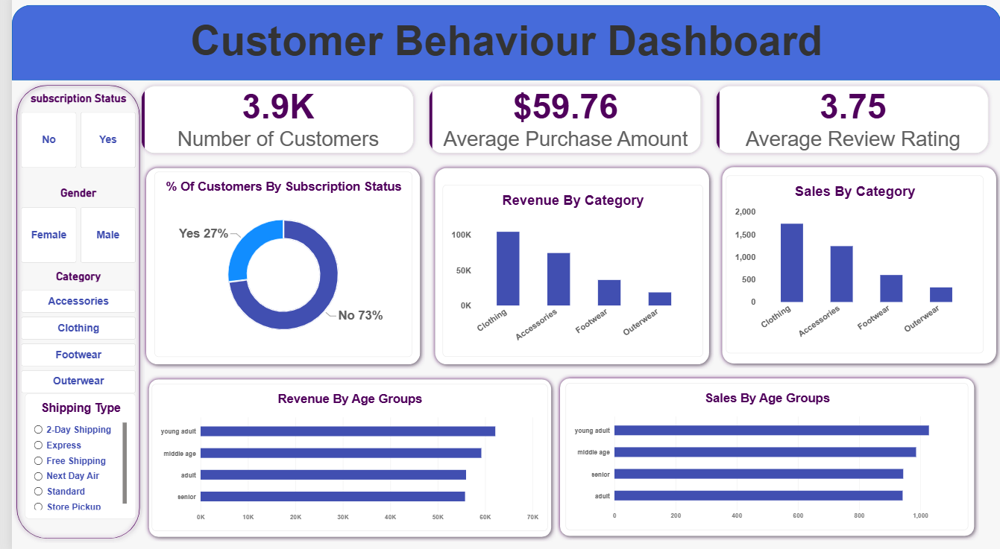
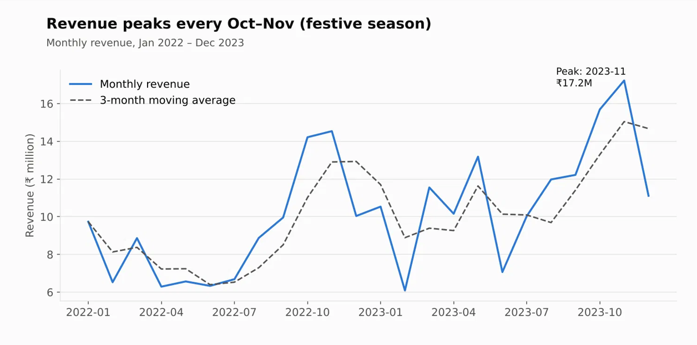
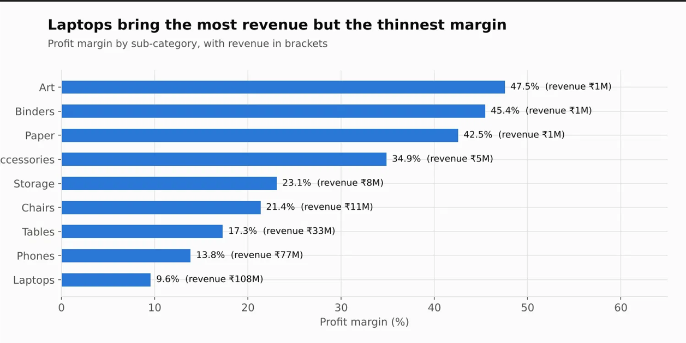
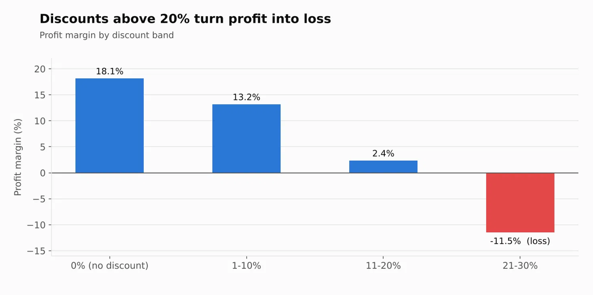
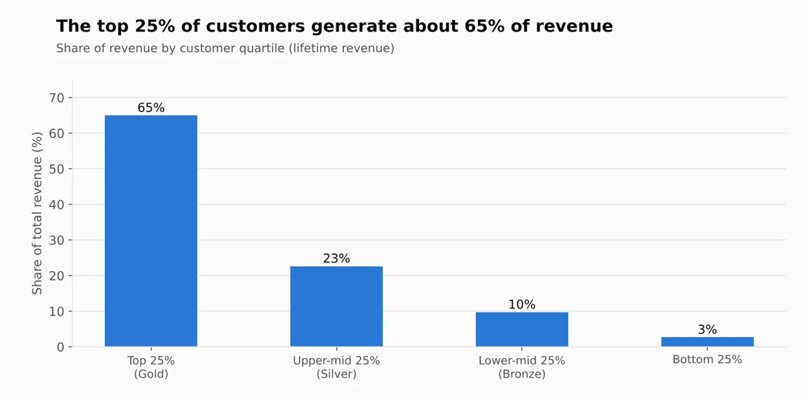

# End-to-End Data Analytics Project

> Python (load and clean) → SQL (15 business queries) → Power BI (dashboard) → Report → Presentation

**Key result:** analysed ₹245.5M of sales across 2 years and found that discounts above 20% turn profit into loss
(−11.5% margin), laptops earn 44% of revenue at the thinnest margin (9.6%), and the top 25% of customers drive 65% of revenue.

---

## Overview

A retailer wants to understand where its revenue and profit come from and where it loses money. This project walks
through the full analytics workflow, from a messy raw file to a decision-ready dashboard, and answers:

- How are revenue and profit trending, and when is the business seasonal?
- Which categories, products and regions drive profit, and which lose money?
- Does discounting help or hurt profitability?
- How valuable and how loyal are the customers?

---

## Dataset

| Item | Details |
|------|---------|
| **Source** | Synthetic retail dataset generated by `scripts.py`. Built to mimic a real store, including realistic data quality problems. Swap in your own CSV to analyse real data. |
| **Raw size** | 8,986 rows × 17 columns |
| **Clean size** | 8,810 order lines × 28 columns · 5,980 orders · 791 customers · 22 products |
| **Period** | Jan 2022 – Dec 2023 |
| **Currency** | Indian rupees (₹) |

**Data problems fixed:** duplicate rows, three mixed date formats, inconsistent casing and spaces, missing values,
invalid quantities, and price outliers.

**Key columns:** `order_id`, `order_date`, `customer_id`, `region`, `segment`, `category`, `sub_category`,
`product_name`, `quantity`, `unit_price`, `discount`, `ship_mode`, `payment_method`

---

## Tools

| Purpose | Tools |
|---------|-------|
| Data loading and cleaning | Python (Pandas, NumPy) |
| Querying and analysis | SQL: runs on SQLite out of the box; scripts are compatible with PostgreSQL |
| Static insight charts | Matplotlib |
| Dashboard | Power BI (DAX, Power Query, star-schema model) |
| Reporting | Markdown report (`project_report.md`) |
| Presentation | Gamma |
| Version control | Git and GitHub |

---

## Steps

### 1. Data loading and cleaning (Python): `scripts.py`
- Loaded the raw CSV and profiled shape, types and missing values
- Removed 120 duplicates, unified three date formats, standardised text, filled or dropped missing values, corrected price outliers
- Created features: revenue, cost, profit, margin, year, month, quarter
- Exported a **star schema**: `fact_orders`, `dim_customers`, `dim_products`

### 2. SQL analysis: `sql/`
- `01_schema.sql` creates the tables, keys and indexes
- `02_analysis_queries.sql` holds **15 queries** using `JOIN`, `GROUP BY`, `CASE`, CTEs, subqueries, `RANK`, `LAG`,
  `NTILE`, running totals and 3-month moving averages
- `scripts/02_run_sql_analysis.py` loads the data, runs every query and exports results to `outputs/query_results/`

### 3. Power BI dashboard: `powerbi/`
- Star-schema model with a Calendar table, DAX measures (`dax_measures.md`) and a custom theme
- Step-by-step build instructions in `DASHBOARD_GUIDE.md`

### 4. Report and presentation
- `report/project_report.md`: findings and recommendations
- `presentation/gamma_prompt.md`: prompt used to generate the slide deck in Gamma

---

## Dashboard


<!-- Add your Power BI screenshot as images/dashboard.png after building the dashboard (see powerbi/DASHBOARD_GUIDE.md). -->

**Three pages:**
1. **Executive Overview:** KPI cards, monthly revenue trend with moving average, category and region breakdown
2. **Products and Discounts:** margin by sub-category, discount-band impact, top products, loss-making lines
3. **Customers and Regions:** revenue by state, top customers, customer value tiers

---

## Results

| Metric | Value |
|--------|------:|
| Revenue | ₹245.5M |
| Profit | ₹33.8M |
| Profit margin | 13.8% |
| Orders / Customers | 5,980 / 791 |
| Average order value | ₹41,050 |
| Revenue growth 2023 vs 2022 | +25.9% |

### Key insights

**1. Revenue peaks every October–November.** The festive season brings 25% of annual revenue.



**2. Laptops earn the most revenue but the thinnest margin.** They are 44% of revenue at a 9.6% margin, while office supplies earn 45% but are under 1% of sales.



**3. Discounts above 20% turn profit into loss.** Margin falls from 18.1% (no discount) to −11.5% (21–30%). 450 order lines lost ₹1.98M in total.



**4. A small group of customers drives revenue.** The top 25% of customers generate 65% of revenue, and customers with 4+ orders are worth about 11× more than one-time buyers.



### Recommendations
- Cap discounts at 15–20% with manager approval above that, especially on Technology products
- Protect laptop margins through pricing and supplier review, and bundle higher-margin accessories (34.9% margin)
- Prepare inventory and staffing for the Oct–Nov peak
- Launch a loyalty programme for the top 25% of customers
- Grow the East region (10.8% of revenue vs 34% each for West and South)

Full write-up: [`report/project_report.md`](report/project_report.md)

---

## How to Run

### Prerequisites
- Python 3.9+
- Power BI Desktop (Windows) for the dashboard
- *(Optional)* PostgreSQL, MySQL 8 or SQL Server if you want to run the SQL on a server instead of SQLite

### Run the Python + SQL pipeline

```bash
# 1. Clone the repository
git clone https://github.com/vedavalliguntuku/retail-sales-analytics.git
cd retail-sales-analytics

# 2. Install dependencies
pip install -r requirements.txt

# 3. Run everything: generate data → clean → SQL → charts
python scripts/run_all.py
```

Or run each step on its own:

```bash
python scripts/00_generate_data.py     # create data/raw/raw_sales.csv (skip if using your own file)
python scripts/01_load_and_clean.py    # clean data → data/cleaned/
python scripts/02_run_sql_analysis.py  # build database, run 15 queries → outputs/query_results/
python scripts/03_make_charts.py       # create insight charts → images/
```

### Use a real SQL server instead of SQLite
1. Create a database and run `sql/01_schema.sql`
2. Load the CSVs from `data/cleaned/` (import commands for PostgreSQL, MySQL and SQL Server are in the schema file)
3. Run `sql/02_analysis_queries.sql`


## Project Structure

```
retail-sales-analytics/
├── data/
│   ├── raw/                  # raw_sales.csv (messy input)
│   └── cleaned/              # star schema CSVs + cleaning_log.txt
├── scripts/                  # Python pipeline (00 to 03) + run_all.py
├── sql/                      # schema and 15 analysis queries
├── powerbi/                  # dashboard guide, DAX measures, theme
├── outputs/query_results/    # CSV result of every SQL query
├── report/                   # project report
├── presentation/             # Gamma prompt for the slide deck
├── images/                   # charts and dashboard screenshots
├── requirements.txt
└── README.md
```

---

## Author

**Vedavalli Guntuku**, Data Analyst
🔗 [GitHub](https://github.com/vedavalliguntuku) · 
---

⭐ If you found this project helpful, feel free to star the repository.
